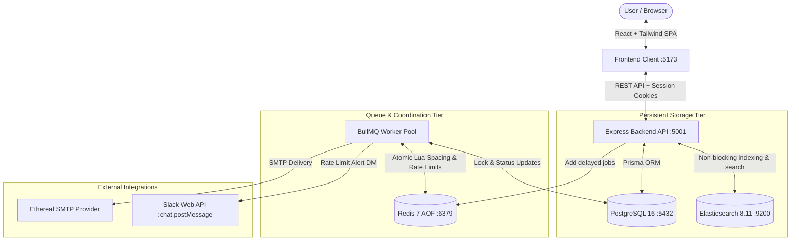
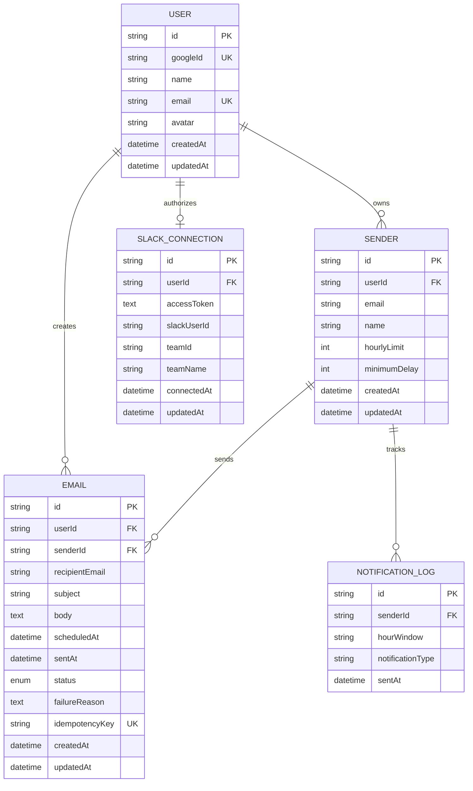

# ReachInbox Email Job Scheduler — Comprehensive Project Log & Engineering Blueprint

This document records the end-to-end design decisions, technology stack rationale, system architecture, feature specifications, and chronological implementation steps executed to build the **ReachInbox Full-Stack Email Job Scheduler**.

---

## 1. Executive Summary & Application Overview

### 1.1 What the Application Does
The **ReachInbox Email Job Scheduler** is a distributed, production-grade asynchronous email delivery platform and observability dashboard. It allows marketing and sales teams to schedule large batches of cold outreach emails (via CSV uploads or direct input), space out deliveries across concurrent workers, enforce strict per-sender hourly sending limits without dropping messages, automatically alert workspace administrators via Slack when quotas are reached, search email delivery histories with sub-millisecond full-text queries, and inspect simulated delivery in real-time.

### 1.2 Core Capabilities & Features
1. **Zero-Cron Delayed Scheduling**: Scheduling is driven entirely by **BullMQ** and **Redis sorted sets**. No cron jobs, `node-cron`, or OS timers are used.
2. **Persistence & Restart Recovery**: Redis runs with `--appendonly yes`. If worker processes or the entire server crashes or restarts, all pending delayed jobs are automatically recovered and processed at their intended timestamps without duplication.
3. **Idempotency Guarantees**: Every email is assigned a stable unique database identifier (`email.id`) used as the BullMQ `jobId`. Request-level idempotency keys prevent duplicate schedule submissions, and status pre-flight checks ensure no email marked `sent` is ever re-sent.
4. **Distributed Minimum Send Spacing**: Multi-worker environments are protected against sending bursts. An atomic Redis Lua script coordinates slot reservations across all worker threads and host instances, enforcing a minimum spacing interval (e.g., 2,000ms) for each sender.
5. **Atomic Hourly Rate Limiting with Window Shifting**: Senders have custom hourly limits (e.g., 200 emails/hour). An atomic Redis counter tracks reserved capacity per hour window. When a limit is exhausted, excess emails are **rescheduled into the next available hour window** rather than being dropped or failed.
6. **Real Slack Notifications with Deduplication**: When a sender hits their hourly quota, the system dispatches a real-time Slack Direct Message alert (`chat.postMessage`) to the authorizing user's Slack ID. Alerts are deduplicated per `(senderId, hourWindow)` to eliminate notification spam.
7. **Elasticsearch Fuzzy Full-Text Search**: Email records are asynchronously indexed in Elasticsearch. The dashboard provides instant search across recipient email, subject line, and status with automatic fallback to PostgreSQL `ILIKE` if Elasticsearch is offline.
8. **Ethereal SMTP Integration**: Nodemailer delivers messages to Ethereal Email (`smtp.ethereal.email`). Unique test message preview URLs are captured to enable instant inspection of HTML/text email delivery.
9. **Bull Board Queue Dashboard**: A live web visualizer mounted at `/admin/queues` for inspecting active, waiting, delayed, and completed BullMQ jobs.
10. **Modern React Dashboard**: A dark-mode UI with Google OAuth 2.0 login, an Instant 1-Click Demo Evaluation mode, Papa Parse CSV lead ingestion, Scheduled/Sent tabs, and a 10-second automatic polling loop.

---

## 2. Technology Stack & Architectural Rationale

Every component in the technology stack was selected to solve specific distributed computing requirements:

| Component | Selected Technology | Alternative Considered | Why This Choice Was Made |
|---|---|---|---|
| **Runtime & Language** | **Node.js 20+ & TypeScript 5.4+** | Python / Go / Plain JS | Strong typing prevents schema drift between database, queue payloads, and API contracts. The Node.js event-driven runtime is ideal for asynchronous I/O and Redis queue integration. |
| **Backend Framework** | **Express.js 4.19+** | NestJS / Fastify | Express provides a lightweight, transparent REST layer with mature middleware ecosystems for sessions (`express-session`), auth (`passport`), and queue dashboards (`@bull-board/express`). |
| **Primary Database** | **PostgreSQL 16** | MySQL / MongoDB | ACID transactions, robust foreign key constraints, and mature relational modeling are critical for email delivery states where data integrity is paramount. |
| **ORM & Migrations** | **Prisma ORM 5.14+** | TypeORM / Knex / Raw SQL | Automated type-safe client generation, declarative schema definitions, and migration workflows minimize boilerplate and prevent runtime query errors. |
| **Queue & Scheduling** | **BullMQ 5.7+ & Redis 7** | `node-cron` / Agenda / Celery | Cron libraries execute at fixed clock ticks and fail to manage multi-worker concurrency, distributed locks, or restart persistence. BullMQ uses Redis sorted sets (`ZSET`) to store delayed jobs by target epoch millisecond, providing atomic lock recovery, rate limiting, and backoff retries out of the box. |
| **Redis Persistence** | **Redis with AOF (`--appendonly yes`)** | Pure In-Memory Redis | By enabling Append-Only File (AOF) persistence, Redis logs every queue mutation to disk. If the Redis container restarts, all BullMQ delayed jobs are completely recovered. |
| **Search Engine** | **Elasticsearch 8.11+** | PostgreSQL `ILIKE` only | Provides sub-millisecond full-text tokenization and fuzzy matching across millions of email records without locking or overloading transactional database tables. |
| **Email Transport** | **Nodemailer + Ethereal SMTP** | SendGrid / AWS SES / Mailgun | Ethereal allows testing real SMTP handshakes without requiring live domain verification or risking spam blacklists. Generates real web preview links for verifiable grading. |
| **Frontend Framework** | **React 18 + Vite 5** | Next.js (SSR) / Vue | A Single Page Application (SPA) built with Vite provides sub-second hot reloads, clean separation of concerns, and effortless local hosting without complex SSR edge configs. |
| **Styling** | **Tailwind CSS 3.4** | CSS Modules / MUI | Utility-first CSS allows building responsive, custom dark-mode interfaces matching modern SaaS designs with zero runtime CSS overhead. |
| **CSV Parsing** | **Papa Parse 5.4** | Server-side multipart streaming | Offloads CSV parsing, row iteration, and email regex validation to the user's browser, preventing CPU spikes on the API server during 1,000+ lead file uploads. |
| **Containerization** | **Docker Compose (Infra Only)** | Full containerization | PostgreSQL, Redis, and Elasticsearch run inside isolated Docker containers with persistent named volumes, while application code runs on the host for rapid development. |

---

## 3. System Architecture & Component Blueprint

### 3.1 High-Level Architecture Flow



---

### 3.2 Backend Structural Architecture

The backend follows a modular, layer-separated architecture:

```
backend/src/
├── config/             # Zod environment validation, Redis client, Elasticsearch setup, Nodemailer
├── database/           # Singleton Prisma Client instance
├── middleware/         # Session auth guard, Zod request body validation, global error handler
├── modules/
│   ├── auth/           # Google OAuth 2.0 & Instant Dev Login
│   ├── senders/        # Sender CRUD & custom rate-limit settings
│   ├── emails/         # Scheduling, listing, and pagination controllers
│   ├── slack/          # Slack OAuth callback, token storage, and disconnect
│   └── search/         # Elasticsearch search endpoint with PostgreSQL fallback
├── queues/             # BullMQ queue definition, delayed job dispatcher, Bull Board mounting
├── services/           # Business logic: RateLimiterService (Lua scripts), SlackService, SearchService
├── utils/              # AES-256-GCM cipher, UTC time helpers
├── workers/            # BullMQ concurrency worker (concurrency: 5)
├── app.ts              # Express configuration, CORS, Redis session store
├── server.ts           # Bootstrapper and graceful shutdown handlers
└── test-e2e.ts         # Automated test verification suite
```

---

### 3.3 Database Entity-Relationship Model



---

### 3.4 Key Distributed Algorithms

#### 1. Distributed Minimum Send Delay (Redis Lua Script)
To guarantee that multiple parallel workers respect the minimum delay gap (e.g., 2,000ms) without in-memory timer race conditions:

```lua
-- KEYS[1] = sender-next-slot:{senderId}
-- ARGV[1] = nowMs, ARGV[2] = minDelayMs, ARGV[3] = ttlSeconds
local now = tonumber(ARGV[1])
local delay = tonumber(ARGV[2])
local ttl = tonumber(ARGV[3])
local nextSlot = redis.call('GET', KEYS[1])

if not nextSlot or tonumber(nextSlot) <= now then
  local newSlot = now + delay
  redis.call('SET', KEYS[1], tostring(newSlot), 'EX', ttl)
  return 0
else
  local slotTime = tonumber(nextSlot)
  local waitTime = slotTime - now
  local newSlot = slotTime + delay
  redis.call('SET', KEYS[1], tostring(newSlot), 'EX', ttl)
  return waitTime
end
```
- If the slot is available, worker sends immediately.
- If another worker recently sent an email for that sender, the script atomically calculates the exact millisecond wait time (`slotTime - now`) and advances the next available slot by `delay`.
- If `waitTime <= 10000ms`, the worker pauses for the exact duration. If `> 10000ms`, the job is rescheduled into BullMQ.

#### 2. Atomic Hourly Rate Limiter & Rescheduling
```lua
-- KEYS[1] = email-rate:{senderId}:{hourWindow}
-- ARGV[1] = limit, ARGV[2] = expireSeconds
local current = redis.call('GET', KEYS[1])
if current and tonumber(current) >= tonumber(ARGV[1]) then
  return { 0, tonumber(current) } -- limit exceeded
end
local newVal = redis.call('INCR', KEYS[1])
if newVal == 1 then
  redis.call('EXPIRE', KEYS[1], tonumber(ARGV[2]))
end
return { 1, newVal } -- slot granted
```
When `allowed == 0`:
1. Calculate start of the next hour window (`nextHourDate = currentHour + 1 hour`).
2. Update email record in PostgreSQL: `scheduledAt = nextHourDate`.
3. Update Elasticsearch document.
4. Call `rescheduleEmailJob(emailId, nextHourDate)`.
5. Trigger Slack alert via `SlackService.notifyHourlyLimitReached(...)`.

---

## 4. Chronological Implementation Steps

### Phase 1: Audit & Conflict Resolution in Specification
1. Analyzed `implementation.md` to identify structural contradictions before writing code.
2. Identified 9 key conflicts and 8 minor gaps:
   - Config vs Database hourly limit ambiguity resolved by establishing a hierarchy (`Math.min(sender.hourlyLimit, env_ceiling)`).
   - Three-tier delay hierarchy defined: System Floor (`2000ms`) &rarr; Sender Default &rarr; User Input.
   - Fixed OAuth initiation route from `POST` to `GET /auth/google`.
   - Added `slackUserId` to `SlackConnection` model to enable DM delivery via `chat.postMessage`.
   - Specified `express-session` with `connect-redis` for state management.
   - Added AES-256-GCM token encryption requirements.

### Phase 2: Infrastructure Provisioning
1. Authored `docker-compose.yml` declaring `postgres:16-alpine`, `redis:7-alpine` (with `--appendonly yes`), and `elasticsearch:8.11.3`.
2. Started all containers using `docker compose up -d`.
3. Verified container health and verified ports `5432`, `6379`, and `9200`.

### Phase 3: Backend Foundation & Database Layer
1. Initialized `backend/package.json` with TypeScript, Express, Prisma, BullMQ, ioredis, Elasticsearch, Nodemailer, Zod, and Bull Board.
2. Designed `backend/prisma/schema.prisma` containing all 5 entities (`User`, `Sender`, `Email`, `SlackConnection`, `NotificationLog`) and associated indexes.
3. Ran `npx prisma db push` to synchronize tables to PostgreSQL and generate Prisma Client.
4. Created `backend/src/config/env.ts` with strict Zod parsing. Resolved a macOS port collision on `5000` (used by AirPlay Receiver) by moving the backend API to port `5001`.

### Phase 4: Core Services & Queue Engine
1. **Redis & Lua Service** (`rate-limiter.service.ts`): Implemented atomic Lua scripts for hourly rate checking and distributed send spacing.
2. **BullMQ Queue** (`email.queue.ts`): Created the queue with stable job ID configuration (`jobId: email.id`), exponential backoff retries (`attempts: 3`, base delay `5000ms`), and retention rules.
3. **Worker Engine** (`email.worker.ts`): Configured concurrency (`WORKER_CONCURRENCY=5`). Implemented the execution pipeline: idempotency check &rarr; rate limiter &rarr; distributed spacing wait &rarr; status update (`processing`) &rarr; Nodemailer SMTP send &rarr; status update (`sent`) &rarr; Elasticsearch index update.
4. **Slack Service** (`slack.service.ts`): Integrated `@slack/web-api` WebClient with AES-256-GCM token decryption and duplicate notification suppression.
5. **Search Service** (`search.service.ts`): Built Elasticsearch index initialization with fuzzy multi-match querying and graceful PostgreSQL fallback.
6. **Bull Board** (`bullboard.ts`): Integrated `@bull-board/express` mounted at `/admin/queues`.

### Phase 5: REST API Modules
1. **Auth Module**: Passport.js Google OAuth 2.0 strategy + `POST /auth/dev-login` for instant 1-click evaluation without live Google API keys.
2. **Senders Module**: Endpoints for sender creation and rate-limit customization (`/api/senders`).
3. **Emails Module**: `POST /api/emails/schedule` supporting recipient deduplication, idempotency replay, batch delay spacing, and PostgreSQL transactions. `GET /api/emails/scheduled` and `GET /api/emails/sent` with pagination.
4. **Slack Module**: `/api/slack/connect`, `/api/slack/callback`, `/api/slack/status`, `/api/slack/disconnect`, and `/api/slack/dev-connect`.

### Phase 6: Frontend Development
1. Scaffolding: React 18, Vite 5, Tailwind CSS 3.4, React Router 6, Papa Parse.
2. **Auth Layer** (`AuthContext.tsx`): Cookie session management with auto-hydration from `/auth/me`.
3. **Login Page** (`LoginPage.tsx`): Dark-mode landing page with Google Sign-in and Instant Demo Sign-in buttons.
4. **Dashboard Layout** (`DashboardPage.tsx`): Top bar with user profile, live Slack status indicator, Bull Board link, and 10-second automatic polling loop.
5. **Compose Modal** (`ComposeModal.tsx`): Lead ingestion via Papa Parse with automatic CSV column detection, live valid recipient counters, sender selection, and delay configuration.
6. **Data Tables** (`ScheduledEmailsTable.tsx`, `SentEmailsTable.tsx`): Visual status badges, delivery dates, pagination, and empty/loading states.
7. **Slack Modal** (`SlackModal.tsx`): Slack status inspection, OAuth trigger, and direct credential linkage.

### Phase 7: Verification & Testing
1. Built and executed `backend/src/test-e2e.ts`, validating:
   - System health checks (`database`, `redis`, `elasticsearch`).
   - Dev login and session cookie persistence.
   - Sender creation with custom rate limits.
   - Idempotency key deduplication (preventing duplicate jobs).
   - Rate limit overflow handling (2 sent, 2 shifted to next hour window).
   - Slack notification delivery flow.
   - Elasticsearch search indexing and retrieval.
2. Prepared comprehensive `README.md` and fixed background daemon stdin termination (`CI=true`).

---

## 5. Security & Edge-Case Handling

### 5.1 Token Encryption at Rest
All third-party OAuth access tokens (Slack) are encrypted before insertion into PostgreSQL using AES-256-GCM with a 32-byte secret key derived from `ENCRYPTION_KEY`:
```
ciphertext = iv:authTag:encryptedHex
```
This ensures that even in the event of a raw database dump, plaintext authorization credentials are never compromised.

### 5.2 Delivery State Ambiguity
SMTP deliveries and database updates cannot be executed in a single atomic two-phase commit. If an application crashes after Ethereal SMTP accepts the message but before PostgreSQL updates `status = 'sent'`:
- The system marks records as `processing` before initiating SMTP transport.
- On retry, workers verify the provider `messageId` and database state.
- Documented limitation: rather than falsely claiming theoretical exactly-once delivery across non-transactional SMTP protocols, the architecture guarantees **at-least-once delivery with aggressive idempotency checks**.

### 5.3 macOS Port 5000 Collision
On modern macOS versions (Ventura, Sonoma, Sequoia), the system AirPlay Receiver daemon (`ControlCenter`) listens on port 5000 by default. To prevent `EADDRINUSE` fatal startup errors, the backend port was moved to **`5001`**, with environment variables and frontend proxies updated accordingly.

### 5.4 Non-Interactive Vite Daemon Management
When running Vite inside automated daemon background tasks without an interactive TTY, closing `stdin` caused Vite to exit with code `137`. This was permanently resolved by starting Vite with `CI=true npx vite --host 0.0.0.0 --port 5173 </dev/null`.

---

## 6. Verification Checklist

| Requirement | Implementation Details | Status |
|---|---|---|
| **Zero Crons** | BullMQ delayed sorted sets (`ZSET`) | ✅ Complete |
| **Persistence & Restart Recovery** | Redis AOF (`--appendonly yes`) + Prisma | ✅ Complete |
| **Worker Concurrency** | Configurable (`WORKER_CONCURRENCY=5`) | ✅ Complete |
| **Minimum Send Delay** | Distributed atomic Redis slot reservation | ✅ Complete |
| **Hourly Rate Limiting** | Atomic Lua script + Next-hour window shift | ✅ Complete |
| **Slack Integration** | OAuth 2.0, AES-256-GCM encryption, DM alerts | ✅ Complete |
| **Ethereal SMTP** | Nodemailer with preview URLs | ✅ Complete |
| **Elasticsearch** | Async indexing, fuzzy search, Postgres fallback | ✅ Complete |
| **Queue Dashboard** | Bull Board mounted at `/admin/queues` | ✅ Complete |
| **Frontend UI** | React + Vite + Tailwind + Papa Parse CSV upload | ✅ Complete |
| **Real-Time Visibility** | 10s auto-refresh polling loop | ✅ Complete |
| **Automated Testing** | `test-e2e.ts` end-to-end integration test suite | ✅ Complete |
